# Client

## Mapbox deployment configuration

Mapbox GL JS needs a valid `pk...` public token at runtime. Set it through
`MAPBOX_PUBLIC_TOKEN` before starting or building the client; the value is
written to the generated, ignored `public/runtime-config.js` file.

PowerShell example:

```powershell
$env:MAPBOX_PUBLIC_TOKEN = 'pk.your-restricted-public-token'
npm run build
```

If PowerShell reports that `npm.ps1` is disabled by the execution policy, use
the Windows command shim instead:

```powershell
$env:MAPBOX_PUBLIC_TOKEN = 'pk.your-restricted-public-token'
npm.cmd start
# or
npm.cmd run build
```

Create a separate restricted token for the web client, with the required
public web-map scopes, and add the local origin, Firebase Hosting domain,
Preview Channel domain, and any custom demo domain in Mapbox Console. Never
use an `sk...` secret token in this client.

## Frontend Responsibility Map

### Home Demo joystick

The joystick chooses its controls from the camera's follow state when pressed:

- Following: up/down moves forward/backward relative to player facing; left/right
  controls continuous turn speed, with damped angular velocity. Sideways-only
  input rotates in place without earning steps.
- Not following: move directly in the screen-relative stick direction using the
  map bearing at gesture start. Facing smoothly turns toward movement, and
  sideways input moves rather than rotating in place.

The control mode and map-bearing reference stay fixed until release, even if
recenter or a map gesture changes following. The next press uses the latest state.
Both modes retain the radial dead zone and strength-based speed; release or
dead-zone entry stops movement and turning. Demo tuning remains in
`src/environments/environment-dev.ts`.

### Home Demo walk check-ins

After confirming a walk, click a selected supply-station marker to open an
Ionic full-height sheet with the same handle-only dismissal as cultivation.
Flick the original station icon horizontally: drag speed determines its release
momentum, so a gentle flick may stop early and a fast flick can continue for
multiple turns. A full net revolution in either direction attempts to claim the
configured reward once per station per walk. Partial turns persist while the
sheet stays open; reversing direction undoes progress rather than counting
back-and-forth motion as a revolution. After an unsuccessful full-turn attempt,
a new gesture starts a fresh revolution. Left/right arrow keys rotate by 45
degrees; reduced-motion preferences suppress the 3D rotation, not the interaction
or progress.

Simply approaching, opening, tapping, or closing grants nothing. At the full-turn
threshold, recheck live session and location within
`TREE_CULTIVATION_RADIUS_METERS` (currently 500 m). Remote attempts show the shared
warning toast without crediting supplies; success always follows actual store
credit, not animation completion. Extra revolutions from one flick do not repeat
the attempt. Previously claimed stations remain visible but cannot be claimed again.
Dismissal starts by stopping the spin and clearing the warning toast immediately.
Station changes, route invalidation, pointer cancellation, backgrounding and
destruction also cancel pending motion. Backdrop/content interaction does not close
the sheet; use its top handle, just as in cultivation.

Each station's `supply` in `demoSupplyStations` is structured data:
`{ resource: 'water', amount: 10 }` or `{ resource: 'fertilizer', amount: 1 }`.
Station previews, walk confirmation totals, check-in copy and credited inventory
all use this value, not the station's challenge kind or a fixed reward multiplier.
The existing six station amounts remain 10 water each until edited.

Click the active destination tree to use its existing cultivation modal, which
also shows `確認打卡終點`. Confirming within the same radius completes the walk and
clears its route/stations/claim tracking, but keeps care open and retains earned
inventory. Closing care then returns to idle. Other trees do not show this action.
Endpoint confirmation grants no extra resource or loyalty reward and does not
require every optional station to have been claimed.

These are in-memory Demo location/gesture check-ins; no photo, Firebase task
completion, or production daily-reward entitlement is added. Reload resets them,
and each new walk starts fresh claim tracking.

### Three.js cultivation prototype

Cultivation backgrounds support `sunny` (晴天), `rainy` (雨天), and `cloudy`
(陰天). Each tree has its own `destination.features[].properties.weather` in
[environment-dev.ts](./src/environments/environment-dev.ts). The ten Demo trees
have mixed, randomly assigned test conditions stored as fixed seed values, so
switching trees updates the background and weather badge while reopening the
same tree keeps its weather. Nearby trees may deliberately have different
conditions for testing; no geographic weather logic is applied.
Edit a tree's `weather` and rebuild/restart to change its test condition.
Sunny weather keeps the original blue sky with no extra sunlight overlay;
the glow produced by feeding light remains unchanged.
Rain includes decorative falling particles; reduced-motion users see
static rain instead. Both WebGL and the SVG fallback use the same weather layer.
Weather never credits water, consumes resources, or changes growth/reward rates.
The selected tree's weather feeds the tree scene's `weather`
input, ready for future location-based Google Weather API data. No live weather
request or API credential is configured yet; the weather provider integration
and failure UI remain future work.

The Home cultivation modal loads the clicked map tree, including its own growth,
fertilizer expiry, growth fractions, and harvest state. It shares `ProgressStore`
inventory with the existing resource cards, but does not update collection trees,
call Firebase, or grant real loyalty points. Home recommendations use the same
current growth as the modal.
Its Demo points balance is separate from the shop's seeded balance and remains
available in the store.
State survives closing/reopening the modal, but resets on page reload.
The SVG preview remains until a nonzero-sized WebGL frame has rendered.
Modal presentation refreshes visibility, dimensions and drawing, and revealing
the WebGL canvas requests another frame. Unchanged dimensions do not reset
the canvas buffer.
Drag the modal handle downward to close it; backdrop dismissal is disabled.
On the map, click a tree to open its care view. Within **500 metres** of the current
player position, care is enabled. Outside that range or without valid location,
the tree remains viewable but care is disabled; leaving the range stops feeding
without closing the modal. Distance uses the shared Haversine calculation, not route length.
Destination selection during planning is unchanged.

Adjust `TREE_CULTIVATION_RADIUS_METERS` in
[environment-dev.ts](./src/environments/environment-dev.ts) to change the range.
The same file's `destination.features[].properties` defines each marker's initial
`growth` and `fertilizerRemainingMs` (zero means no active fertilizer).
Seed growth scales with `TREE_GROWTH_PER_HARVEST`. Five trees start fertilized and
five do not; remaining durations start when the frontend store is initialized
and expire normally without consuming inventory. Growth and fertilizer changes
survive switching trees or closing the modal, but reload restores these seeds.

The expanded scene has a draggable resource dock. Hold the sun inside the
indicated tree range to feed at the configured rate. Water changes to a watering
can when held and continuously pours inside the range.
Fertilizer glow/sparkles sit above the soil but behind the tree. WebGL composites
soil, fertilizer, then tree/fruit without letting soil depth hide the six stars;
the soil depth still hides the buried seed. The SVG fallback inserts the effect between soil
and tree, so it scales with the preview rather than overlaying the whole scene.
The too-far interaction toast is dismissed as soon as cultivation starts
closing. Pending toast creation/presentation is cancelled logically to prevent
a late warning appearing after closure; repeated warnings replace the old one.

Each tree seeds `destination.features[].properties.weedCount` in
[environment-dev.ts](./src/environments/environment-dev.ts). Click a weed on
the soil to remove exactly that plant, or focus it and press Enter/Space. Both
WebGL and SVG use the same individually labelled controls. Removal requires
the same cultivation radius as feeding (currently 500 m); remote attempts show
the existing warning toast without removing anything. Pulling weeds costs and
grants no resources or points. Per-tree removals survive modal closure and tree
switches; reload restores configured counts. There is no automatic regrowth.

At `TREE_WEED_PENALTY_THRESHOLD` (default **10**) or more weeds, a per-tree debuff
activates and new light/water allocations convert at **90%** of normal.
Once activated it remains even at nine or one weed, including across tree
switches and modal closure. **Only clearing all weeds (zero remaining) releases
the debuff.** A tree seeded with fewer than ten weeds starts without a debuff.
Fertilizer multiplies the rate:
**1.2 x 0.9 = 1.08**, or **108%** while both effects apply. The modal shows the
remaining count and current conversion rate. Existing growth and fractional
earnings are never reduced. Integer 1/7,500-growth ticks preserve exact results
across small allocations, removing weeds and fertilizer transitions.

Demo default rates come from `LIGHT_ENERGY_PER_SECOND` and
`WATER_DROP_PER_SECOND` in [environment-dev.ts](./src/environments/environment-dev.ts).
The current compact resource dock does not expose rate inputs. The component
retains positive-integer rate validation; changing a rate stops current feeding.
One eligible step now earns one light energy, capped at **7,500 light per Taipei
calendar day**. New steps credit light automatically; repeated conversion does
not recredit spent light. Steps remain displayed even above the cap, and a new
day cannot convert yesterday's steps.
**150 light = 1 base growth** and **1 water drop = 10 light-equivalent units**,
so **15 drops = 1 base growth**. Fertilizer adds 20% to both: 150 light or
15 drops earn 1.2 growth; 125 light or 25 drops earn 1 or 2 growth respectively.
Fractional growth uses integer 1/7,500-growth ticks and survives gestures, rate
changes, modal closure, and fertilizer activation/expiry without rounding loss.
The compact heading displays whole-growth progress; fractional growth remains
in state even when a feeding batch has not earned a whole growth point yet.
While below the target, an affordable final batch is charged in full even if it
exceeds the remaining growth. Credited growth caps at the **configured target / 100%**; excess
growth and any final fraction are discarded, not refunded or carried forward.
Feeding stops after that batch, and
additional allocations at 100% are rejected without spending.
Feeding uses elapsed
in-range time, not frame count, and spends whole resource units every 50 ms,
carrying sub-unit time until the gesture ends. Leaving the range pauses feeding;
release, cancellation, blur, hidden/offscreen scenes, or closing the modal stop
it with no background catch-up. Releasing water stops pouring and does not add an
extra drop. Dropping fertilizer activates a **24-hour +20% effect** on
all subsequent light and water feeding, consuming one fertilizer immediately.
Activation is limited to once per Taipei calendar day; active effects cannot
stack or restart. Earned growth fractions carry across ticks rather than being lost
to per-frame rounding. Remaining duration is displayed and effects survive
modal closure. Drops outside the range consume nothing.

Keyboard users can focus a resource and press Enter: water/fertilizer activate
once for fertilizer, while sun/water toggle the configured continuous feeding
rate on/off.
Reaching **100% of the configured growth target** produces **50 small yellow
leaf-icon particles**, one per Demo point. They share an original SVG texture;
WebGL draws one `THREE.Points` object rather than volumetric fruit meshes.
Ripe particles cluster inside the five foliage volumes and use depth occlusion:
most remain concealed, with only a few glimpses among the leaves rather than a
flat disk of 50 visible icons in front of the canopy. The SVG fallback conceals
40 icons and partly covers the other ten with leaves. During harvest, both
renderers reveal all 50 particles for the fall. Drag the tree left
and right with three deliberate reversals within 1.5 seconds.
The current compact modal omits the standalone harvest panel/button; the
component/store harvest action remains available for UI wiring.
Fruit falls and automatically credits
**50 Demo 小樹點** after landing; no extra pickup is needed.
Particles fall in staggered groups, scatter within the soil base, and bounce
lightly. All 50 land within the existing 1,150 ms reward deadline; their number
does not multiply the reward.
The store accepts
one harvest per tree per planting cycle, independently of other trees on the
same calendar day, and rejects duplicate gestures for that tree during its
recovery period. This
Demo rule supersedes the previous account-wide daily harvest limit; daily
fertilizer/light limits are unchanged. Accepted falls finish even if the modal
closes. Harvest preserves the large tree and its completed growth for 24 hours
after the fruit lands and points are credited. During that period its map marker
uses a gray `arrow-redo` Ionicon; opening its cultivation modal keeps a toast
visible with the whole hours remaining. After 24 hours the site becomes an
empty planting point, and a new seed starts another harvest cycle. Previously
credited points and same-day destination completion are preserved. Points,
harvest state, and resources remain session-local.
Integration with the shop's seeded balance remains unwired.

The 50-point harvest is the conversion of accumulated growth, not a second reward
on top of redeeming the same task value. The confirmed 150:1 light/growth ratio
makes the economic-reference 5,000-growth harvest cost **750,000 light/eligible steps**,
or 100 qualifying capped days. At that reference, a water-only harvest requires **75,000 drops**
without fertilizer or overflow. Water/fertilizer accelerate growth through extra task effort.
Seeded Demo inventory and configurable feeding rates are not real earning rates;
The owner confirmed 5,000 growth as the economic reference, while development
can temporarily use a smaller environment target to test the complete lifecycle.
The 50-point reward and feeding-rate settings remain unchanged.

The reusable `TreeSceneComponent` lazy-loads pinned Three.js directly, generates
a low-poly tree at thresholds derived from `TREE_GROWTH_PER_HARVEST` in
[environment-dev.ts](./src/environments/environment-dev.ts), and retains a small
growth pulse rather than particle fields. Free model rotation is disabled.
Only mature/large trees (60%+ of target) in an interactive scene respond to
horizontal dragging with a gentle sway capped at +/-5 degrees, returning upright
on release. Ordinary sway changes no resources, growth, rewards, or fruit state.
Only ripe fruit with harvest permission enables the reversal gesture to trigger
fruit falling. Sway remains available after harvest, but cannot grant another
reward; interaction is disabled during fruit falling and for younger stages.
Stage boundaries are **10% seedling, 30% young, 60% mature, 100% large**; growth
below 10% remains a seed. A development target of 100 yields
10/30/60/100; changing it to 5,000 yields 500/1,500/3,000/5,000.
The same stage function drives WebGL, SVG, labels, growth pulses, and interaction
gates, so only the environment target needs editing.
Model size stops increasing at the mature stage in both WebGL and SVG.
Large/ripe trees retain mature dimensions with fruit aligned to the capped canopy;
mature/large growth pulses shrink and return without exceeding that size.
Stage labels, growth thresholds, sway, and harvest eligibility are unchanged.
Set the target to a positive safe integer; invalid targets fail explicitly.
Its transparent canvas sits over a blue sky, white clouds, and green hills.
The ground base is brown soil. The seed is half buried: WebGL places its center
at the ground's top surface, allowing the opaque soil to hide its lower half.
The SVG fallback shows an exposed upper seed cap and a small foreground soil rim.
Changing the 3D ground height or vertical position also adjusts seed planting
depth; watering still aims at the soil/root point.
Light feeding adds a broad, static glow at the top of the sky and brightens
the model, without a background sun disk or drawn light rays.
Water feeding rotates the held can toward the projected trunk base/soil
(the soil point for the seed), separately from the feeding-range center.
On the right side the can is horizontally mirrored. Tilt is bounded to 75 degrees
to keep its opening upright, including near-vertical pours.
Its nozzle stays at the pointer; a bounded 60-drop curved ribbon pours onto
the root, with 12 small impact splashes. Visual droplets do not change the
configured resource consumption or growth. The stream is an absolute, clipped
layout-level overlay,
so starting or stopping it does not squeeze the canvas or shift the feeding range.
The can has no circular backdrop. Aim updates with stage and resize changes.
Reduced motion shows stationary stream droplets and splashes, with fruit placed
on the ground without a falling/shaking animation. No cone-shaped particle system
or separate particle engine is used.
It caps pixel ratio at 1.5, uses no shadows/post-processing, renders only on
changes or during feeding/effects, pauses while hidden/offscreen, and disposes its
renderer/geometries/materials/observers on teardown. Only one instance owns a
renderer. SVG remains available while loading, on initialization/context failure,
or with reduced-motion settings. The S22+ performance and twenty-navigation
memory spike remain required before accepting this optional feature.

### Home Demo task-point planning

All map trees use green circular markers with white tree silhouettes. Unselected
markers ripple; the selected destination has a double outline and check badge.
Planning first lets clicks select a candidate tree or empty planting point.
Press `確定此終點` in the upper destination card to lock it without departing.
Then click other eligible trees, empty points or supply stations to open a
compact `加入路線` / `移出路線` popup. Closing it does not change selection.
The destination cannot change after locking; return and start a new plan
to choose another. Harvested/today-completed points are view-only and cannot
be added as intermediate stops during the 24-hour recovery period. After
recovery, the site becomes an empty planting point. Recheck eligibility before departure; a
selected stop that becomes unavailable can still be removed. Tree/empty-point
stops use ordinary optional care/planting, not station resource rewards or
new mandatory check-ins. Once a route is confirmed for departure,
hide all tree markers except its destination and selected intermediate points, keeping selected
supply stations visible. This also applies during cultivation and after arrival
while the route remains active. Restore all trees when the route ends or is
cancelled. Visible tree markers retain the existing cultivation interaction
outside planning.

Entering planning automatically opens three compact recommendation popups at
the highest-ranked trees. Cards show nickname/species, place, approximate walking
steps and a per-tree recommendation reason using the same live Demo progress
as the planner. Clicking a card selects its tree; other markers remain selectable
without opening extra popups. Before choosing a destination, use
`隱藏推薦資訊` / `顯示推薦資訊` to toggle these cards without hiding tree markers or
moving the camera. Selecting any tree removes all recommendation popups and
hides the toggle; it cannot reopen them over a selected destination.
New plans reset recommendation visibility. Recommendation popups are removed
outside planning. The initial camera fits the player and all three recommended positions
inside the planning-panel gap, reserving card space rather than using a fixed
zoom. Popup anchors are chosen to avoid overlap/clipping where space permits,
and placement is recalculated after map movement and resizing.

Recommendation logic is in
[home-tree-recommendations.ts](./src/features/home/home-tree-recommendations.ts).
Within the 8,000-step group, reason priority is `可收成` > `即將收成` >
`缺水了` > `附近雜草叢生` > `即將進入新階段`. Each tree shows only its highest
priority reason, prefixed by `種子` / `樹苗` / `小樹` / `大樹` at the shared
0% / 10% / 30% / 60% stage thresholds. Harvest-ready starts at 100%;
near-harvest starts at 90%. Near-next-stage is within 5% of the harvest target
of the next stage. Dryness reuses the strictly-over-seven-days care rule;
weeds use the configured count threshold rather than the persistent debuff.
Trees with no reason fill remaining slots using the previous ordering;
beyond 8,000 steps, fallback remains nearest-first. Harvested trees have no
actionable reason. Reasons reflect live growth, remaining weeds and watering
timestamps, with a minute clock only while planning has no selected destination.

Edit `demoSupplyStations` in
[environment-dev.ts](./src/environments/environment-dev.ts) to configure each
station's `id`, `name`, `category`, `isCathayTwqrMerchant`, `offer`, `terms`,
`validUntil`, and resource `kind` (`water` / `fertilizer`). `routeFraction`
sets its anchor progress along the main route (0 to 1); `estimatedExtraSteps`
sets the initial simulated detour distance. Mapbox replaces that step estimate
with its road-distance estimate after loading. This single list supplies both
the map stations and their merchant-detail popups; store/offer data is Demo fiction.
Planning station details use a Mapbox popup anchored to the clicked marker,
not the shared bottom sheet. The rounded card retains category/TWQR badges,
offer terms, expiry, current-location distance, approximate extra minutes, and
configured resources. Its width fits narrow screens and long content scrolls.
The compact card is at most 260px wide and 300px tall, further constrained by
the visible gap between planning panels. Route action buttons remain visible
outside the scrolling details. Opening it automatically pans the map only as
needed to fit the popup within 12px edge/panel margins, without changing zoom
or bearing; resizing refits it.
Only one station/tree-stop detail popup is open at a time; changing the destination, replacing
station routes, or leaving planning closes it. Active-walk station check-in
continues to use its existing spin/check-in modal.

Select a tree destination to request a main walking route from Mapbox Directions v5.
The configured virtual supply stations preload with that route. Their markers
and selection actions appear only after pressing `確定此終點`, once loading
has finished. The three configured empty planting points also remain selectable
as destinations or intermediate stops; no planting-task reward is added.

Candidate placement initially targets about 800–1,000 extra steps for water and
2,000–3,000 for fertilizer, but markers show the actual Mapbox road-distance
estimate after loading, even if outside those ranges. All configured stations are retained.
Each challenge requests an out-and-back walking route from an existing main-route
road vertex. Task markers use the snapped coordinates returned by Mapbox.
The marker estimate is a single-challenge reference; continuous routes may share detours.
Added detours do not introduce more candidates.
Click a supply-station marker to view its merchant-detail popup. Only `加入路線`
adds it, and `移出路線` removes an already-selected station. Closing it with
the close button, `下次再來`, Escape, or a map click leaves selection unchanged.
Selected orange markers show a check badge.
Nearby tasks are not displayed as bottom cards. Toggling tasks changes the draft
selection, not the displayed route, and leaves the current camera position,
zoom, and bearing unchanged. Press `更新路線` when ready to request one continuous
walking route: origin → selected station/tree/empty points → destination. Stops follow their
order along the original route, with no mandatory return to each anchor.
Until updating succeeds, the UI explicitly labels the route/distance as the last
result and prevents departure. Total distance/steps come from this complete
Directions response (0.75 m/step), not the sum of marker estimates.
Updating the route also leaves the camera unchanged.
Choosing a different candidate before locking, or cancelling/restarting,
clears the selected points. Destination framing uses the measured gap between
the planning panels, with the destination toward the upper card and the player
toward the lower card, while keeping the route visible. Camera measurement
runs after rendering so the selected-destination card is included.
Planning applies a small +0.15 zoom adjustment to this fit (up to zoom 19);
walking keeps its fitted zoom unchanged.
Press `確認規劃，開始散步` after updating the selected tasks (or choosing none)
to enter Walking; starting the walk retains them.

Each endpoint selection uses one main-route request and six detour requests,
with full GeoJSON geometry and the `mapbox/walking` profile. These six previews
estimate individual challenges only; their out-and-back geometry is not stitched
into the final route. Task toggles do not call the API.
Each new task combination submitted through `更新路線` adds one request with at most
eight coordinates. Completed combinations are cached only for the current plan;
reusing one adds no requests, and deselecting all tasks restores the original
route without a request. Endpoint changes, cancellation, and leaving Home clear
the cache. A cancelled request already sent may still count toward API billing.
Real dead-end roads may still require an unavoidable return even though the app
does not add branch-like detours itself. Requests have
a 20-second timeout; changing the endpoint, cancelling, or leaving Home aborts
outstanding work. API errors are visible and retryable, never replaced by
straight lines or silently seeded routes. Routing must finish before confirmation.
Directions coordinates are sent transiently to Mapbox, not stored or logged.
The public token must be valid for Directions and the deployed origin; requests
are subject to the Mapbox account's quota and billing.

The SVG markers and virtual tasks are illustrative, not field-approved POIs.
This flow does not grant rewards, consume seeds, or implement photo check-in.

前端採用「畫面元件負責呈現、Store 負責狀態、Repository 負責資料來源」的分工。依賴方向由上往下，低層不應反過來直接操作上層畫面。

```mermaid
flowchart TD
    User[使用者操作]
    App[App Shell / Router\napp.component.ts / app.routes.ts]

    subgraph Features[Feature Pages：頁面與使用者互動]
        Home[HomeComponent\n首頁儀表板]
        Task[TaskComponent\n任務頁]
        Collection[CollectionComponent\n收藏 / 記憶森林頁]
        Shop[ShopComponent\n商店頁]
        Profile[ProfileComponent\n個人頁]
    end

    subgraph State[Signal Store：畫面狀態與用例協調]
        Session[SessionStore\n登入、Demo、執行狀態]
        Progress[ProgressStore\n步數、光能、水滴、肥料]
        TaskStore[TaskStore\n任務進度與完成狀態]
        CollectionStore[CollectionStore\n樹木 / 收藏資料]
        ShopStore[ShopStore\n商店與兌換狀態]
    end

    subgraph Data[Repository：資料存取邊界]
        ProgressRepo[ProgressRepository\n讀取活動、資源、小樹點]
        FutureRepos[其他 Repository\nTask / Collection / Shop]
    end

    External[Firebase / Firestore\nAuth、資料、Storage]
    Device[裝置能力\n步數、GPS、相機]
    Trusted[Trusted Commands\nCloud Functions / 後端命令]

    User --> App
    App --> Home
    App --> Task
    App --> Collection
    App --> Shop
    App --> Profile

    Home --> Session
    Home --> Progress
    Task --> Session
    Task --> TaskStore
    Collection --> Session
    Collection --> CollectionStore
    Shop --> Session
    Shop --> ShopStore
    Profile --> Session

    Session --> ProgressRepo
    Progress --> ProgressRepo
    TaskStore --> FutureRepos
    CollectionStore --> FutureRepos
    ShopStore --> FutureRepos

    ProgressRepo --> External
    ProgressRepo --> Device
    FutureRepos --> External
    Session --> External
    TaskStore --> Trusted
    CollectionStore --> Trusted
    ShopStore --> Trusted
```



### 各層負責什麼

| 層級                | 主要責任                     | 可以做                                                               | 不應該做                                   |
| ------------------- | ---------------------------- | -------------------------------------------------------------------- | ------------------------------------------ |
| `App / Router`      | 應用程式外框與頁面導航       | 設定路由、lazy loading、共用 layout                                  | 放步數計算、Firebase 查詢或商業規則        |
| `Feature Component` | 顯示畫面與接收使用者事件     | 綁定 template、顯示 loading/error、呼叫 Store method                 | 直接呼叫 Firestore、在畫面內堆複雜商業邏輯 |
| `Signal Store`      | 管理某個功能的狀態與畫面用例 | 保存 state、computed、觸發讀寫、組合多個資料來源                     | 直接把 Firestore query 散落在各個元件      |
| `Repository`        | 封裝資料來源與資料格式轉換   | Firestore query、Auth/Device API、Demo data、Observable/Promise 轉換 | 決定按鈕怎麼顯示、處理頁面導向或 UI toast  |
| `Trusted Commands`  | 執行需要信任邊界的寫入       | 原子性資源扣除、任務完成、收割小樹點                                 | 被畫面直接當成一般資料查詢使用             |

### 實際資料流範例

以首頁顯示今日步數為例：

```text
HomeComponent
  -> ProgressStore.watch / initialize
    -> ProgressRepository.watchDailyActivity('Asia/Taipei')
      -> Firestore 或裝置步數來源
    <- 今日有效步數與已取得光能
  <- template 顯示步數、資源與進度條
```

以「培育樹木並收割小樹點」為例，流程會由 Store 協調，真正需要信任的寫入交給後端命令：

```text
CollectionComponent
  -> CollectionStore.previewNurture(...)
  -> 使用者確認
  -> CollectionStore.nurtureTree(...)
    -> Trusted Command：驗證距離、資源、harvestReady 與每日上限
      -> 原子更新 Firestore
    <- 新的樹木進度與可收割狀態
  <- 更新畫面並顯示收割入口
```

### Repository 與 Service 的命名界線

目前前端以 `Repository` 表示「資料怎麼取得或保存」，例如 `ProgressRepository`；它不代表畫面流程，也不應承擔完整的產品規則。

若未來出現需要組合多個 Repository、計算複雜規則或編排一整個使用者流程的邏輯，再加入 `Service` 層會比較合適：

```text
Component -> Store -> Service -> Repository -> Firebase / Device
```

例如 `NurtureService` 可以負責組合樹木、資源與收割條件；但單純讀取今日步數仍應留在 `ProgressRepository`，不需要為了命名而額外包一層。

### 命名與檔案位置

- 頁面功能放在 `src/features/<feature>/`，例如 `task/`、`collection/`。
- 跨頁共用狀態放在 `src/shared/stores/`，例如 `SessionStore`、`ProgressStore`。
- 資料存取放在 `src/shared/repositories/`，例如 `ProgressRepository`。
- Client 實作名稱使用 `Collection`、`Task`；產品畫面文字仍可使用「森林」與「任務」。
- 後端既有的 `missionId`、`completeMission` 等契約名稱維持不變。
# 身分隔離與散步資料儲存

Demo 使用原有記憶體 mock，離開或切換帳號不會將其寫入 Firebase。
正式身分以 Firebase UID 儲存背包、樹木養成、收成點數、補給領取紀錄與每日步數；
每日步數／光能以台北日期分開紀錄。正式身分不顯示模擬搖桿；本次不串接手機計步來源。

部署本次功能需要更新 `firestore.rules`，以及 asia-east1 的
`initializeWalkProgress`、`saveWalkProgress` 兩個 callable Functions。
尚未部署時前端會顯示載入失敗，不能將本機測試通過視為雲端已可用。
可以使用 `firebase deploy --only functions:initializeWalkProgress,functions:saveWalkProgress,firestore:rules`。

雲端資料位置：`users/{uid}/progress/current`、`users/{uid}/inventory/current`、
`users/{uid}/dailyProgress/{YYYY-MM-DD}`。同步採版本檢查與資源差額更新，
避免覆蓋其他裝置或後端任務獎勵；遇到衝突以畫面上的重新載入按鈕恢復。
斷線不會切回 mock，也不會把未確認資料標示為同步成功。
這是展示範圍的客戶端回報紀錄；商店、圖鑑與健康平台串接不屬於此變更。
