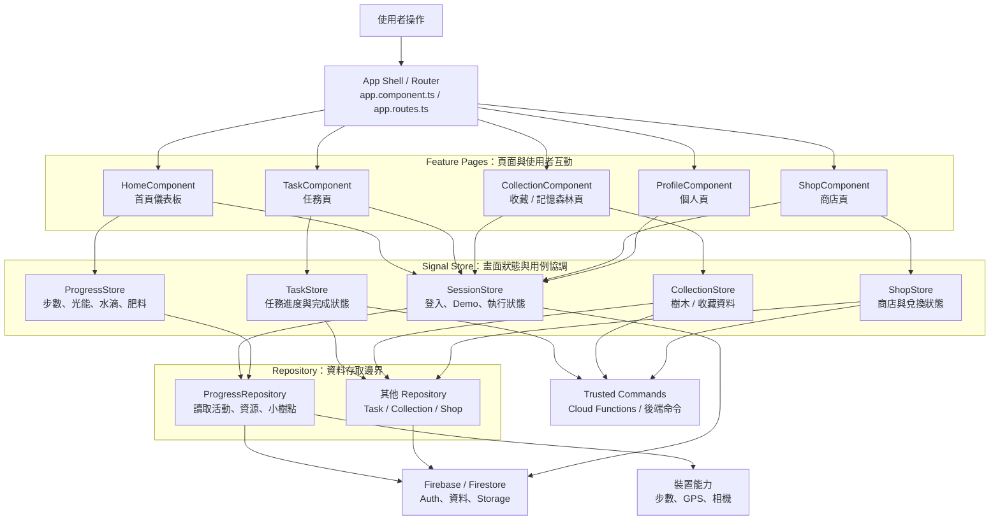

# Client

## Frontend Responsibility Map

前端採用「畫面元件負責呈現、Store 負責狀態、Repository 負責資料來源」的分工。依賴方向由上往下，低層不應反過來直接操作上層畫面。



### 各層負責什麼

| 層級 | 主要責任 | 可以做 | 不應該做 |
| --- | --- | --- | --- |
| `App / Router` | 應用程式外框與頁面導航 | 設定路由、lazy loading、共用 layout | 放步數計算、Firebase 查詢或商業規則 |
| `Feature Component` | 顯示畫面與接收使用者事件 | 綁定 template、顯示 loading/error、呼叫 Store method | 直接呼叫 Firestore、在畫面內堆複雜商業邏輯 |
| `Signal Store` | 管理某個功能的狀態與畫面用例 | 保存 state、computed、觸發讀寫、組合多個資料來源 | 直接把 Firestore query 散落在各個元件 |
| `Repository` | 封裝資料來源與資料格式轉換 | Firestore query、Auth/Device API、Demo data、Observable/Promise 轉換 | 決定按鈕怎麼顯示、處理頁面導向或 UI toast |
| `Trusted Commands` | 執行需要信任邊界的寫入 | 原子性資源扣除、任務完成、收割小樹點 | 被畫面直接當成一般資料查詢使用 |

### 實際資料流範例

以首頁顯示今日步數為例：

```text
HomeComponent
  -> ProgressStore.watch / initialize
    -> ProgressRepository.watchDailyActivity('Asia/Taipei')
      -> Firestore 或裝置步數來源
    <- 今日有效步數與已取得光能
  <- template 顯示步數、資源與進度條
```

以「培育樹木並收割小樹點」為例，流程會由 Store 協調，真正需要信任的寫入交給後端命令：

```text
CollectionComponent
  -> CollectionStore.previewNurture(...)
  -> 使用者確認
  -> CollectionStore.nurtureTree(...)
    -> Trusted Command：驗證距離、資源、harvestReady 與每日上限
      -> 原子更新 Firestore
    <- 新的樹木進度與可收割狀態
  <- 更新畫面並顯示收割入口
```

### Repository 與 Service 的命名界線

目前前端以 `Repository` 表示「資料怎麼取得或保存」，例如 `ProgressRepository`；它不代表畫面流程，也不應承擔完整的產品規則。

若未來出現需要組合多個 Repository、計算複雜規則或編排一整個使用者流程的邏輯，再加入 `Service` 層會比較合適：

```text
Component -> Store -> Service -> Repository -> Firebase / Device
```

例如 `NurtureService` 可以負責組合樹木、資源與收割條件；但單純讀取今日步數仍應留在 `ProgressRepository`，不需要為了命名而額外包一層。

### 命名與檔案位置

- 頁面功能放在 `src/features/<feature>/`，例如 `task/`、`collection/`。
- 跨頁共用狀態放在 `src/shared/stores/`，例如 `SessionStore`、`ProgressStore`。
- 資料存取放在 `src/shared/repositories/`，例如 `ProgressRepository`。
- Client 實作名稱使用 `Collection`、`Task`；產品畫面文字仍可使用「森林」與「任務」。
- 後端既有的 `missionId`、`completeMission` 等契約名稱維持不變。