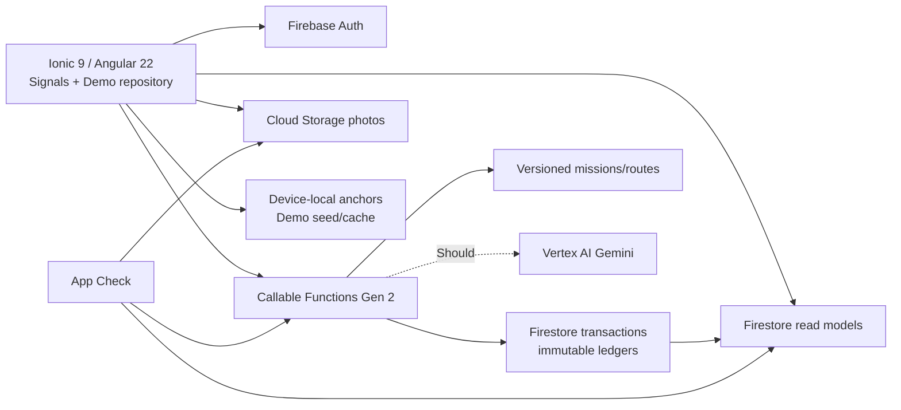

# 系統設計：Firebase/GCP Serverless Demo

版本：1.0  
日期：2026-09-03

## 1. 架構結論

本專案不建立 Java 或 .NET 應用後端。Ionic／Angular client 直接使用 Firebase Hosting、Authentication、Firestore 與 Storage；所有會改變步數、資源、樹木成長或 mock 小樹點價值的操作，只能經由五個 TypeScript Cloud Functions Gen 2 callable commands 完成。

Must 路線採「版本化且人工檢查的模板＋規則式排名」。因此無外部地圖路線服務也可完成主流程；Gemini 只做 Should 等級的受限偏好解析。

## 2. Runtime 與環境

- 前端：Ionic 9、Angular 22、TypeScript 6、Angular Signals。
- 後端命令：Firebase Functions Gen 2、TypeScript；區域預設 `asia-east1`，若既有專案限制衝突再更改並記錄。
- 資料：Cloud Firestore；照片：Cloud Storage；登入：Firebase Authentication Google provider。
- 部署：Firebase Hosting Preview Channels 作為 PR／Demo 驗收點。
- 開發：Firebase Emulator Suite，含 Auth、Functions、Firestore、Storage 與 Rules tests。
- 機密：Secret Manager；client 不包含 server API key 或 service-account 憑證。
- 防護：App Check、Security Rules、命令端驗證、idempotency key。
- 環境數：一個共用 Demo Firebase project，加本機 emulator；兩個月內不建立獨立 production。

## 3. Client 邊界

### 3.1 可由 client 處理

- UI state、navigation、動畫、路線與樹的 read model。
- exact home/work anchor 的裝置本機儲存。
- Demo 步數模擬控制與離線 seed repository。
- 拍照／選檔與 local pending upload queue。
- 養分投入結果預覽；server 仍須重新計算。

### 3.2 不可信任 client 處理

- 發放光能、水滴、肥料、種子或 mock 小樹點。
- 判斷任務是否已領每日獎勵。
- 扣除資源、增加樹木成長、建立 `harvestReady`。
- 收成、兌換、捐贈或 ledger 寫入。
- 用 client 傳入的成長值、價格、獎勵值直接寫資料庫。

## 4. 五個 callable commands

所有 command 接受 client 產生的 UUID `idempotencyKey`，驗證 `auth.uid`、App Check、schema 與 `isDemo` 邊界。成功結果與 ledger 在同一 transaction 中寫入；相同 key 重送只回傳先前結果。

### 4.1 `syncDailySteps`

用途：同步某來源的當日累計步數，依最大累計值發出新增光能。

主要輸入：`source`、`localDate`、`cumulativeSteps`、`isDemo`、`idempotencyKey`。  
主要規則：`Asia/Taipei` 日界線、來源單調增加、跨來源取 max、只對新增的完整 500-step block 發放。  
主要輸出：有效步數、總光能、此次新增光能、下一門檻。

### 4.2 `completeMission`

用途：完成種植、取水或養分配送並依每日規則發資源。

主要輸入：`missionId`、checkpoint proof、photo object path、proximity proof／Demo simulation、`isDemo`、`idempotencyKey`。  
主要規則：seed mission 版本存在；照片路徑屬於本人；每日首次獎勵；種植另檢查 seed 並建立 tree；pickup 本身不要求照片。  
主要輸出：completion、獲得資源、treeId（種植時）、是否為重玩。

### 4.3 `nurtureTree`

用途：原子扣除養分並增加指定樹的 owner growth。

主要輸入：`treeId`、`lightEnergy`、`useWater`、`useFertilizer`、`proximity`、`isRemote`、`idempotencyKey`。  
主要規則：重新計算整數成長值；肥料每樹每日一次；不可跨過無法領取的第二個里程碑；全帳號最多一個 `harvestReady`；失敗零扣款。  
主要輸出：扣除明細、前後成長值、階段、`harvestReady`、最大允許投入提示。

### 4.4 `redeemReward`

用途：近距離收成里程碑，或從 mock catalog 兌換／捐贈。

主要輸入：`operation` (`harvest|catalog|esg`)、`treeId` 或 `catalogItemId`、proximity proof、`idempotencyKey`。  
主要規則：收成必須約 150m 內或 Demo 模擬、每日一次、只能領當前 ready milestone；catalog 依 seed price 扣 mock 點數。  
主要輸出：wallet balance、不可變 ledger entry、下一個門檻。

### 4.5 `recommendRoute`

用途：從六條已核可路線模板中，挑出符合通勤方向與額外時間的任務。

主要輸入：current location、暫時性的 next-destination anchor、area、extraMinutes、tripShape、missionType、結構化偏好或 Gemini 解析結果。  
主要規則：不持久化 exact anchors；只回傳 seed 中存在的 mission／route；超出範圍回傳最接近選項或明確無結果；8 秒內未完成即 client 使用本機模板。  
主要輸出：`missionId`、`routeTemplateId`、排序理由、距離、時間、polyline、checkpoint。

## 5. 建議 Firestore 模型

集合名稱是初始設計，實作時若更改必須同步本文件與 Rules tests。

| Path | 內容 | Client 寫入 |
| --- | --- | --- |
| `users/{uid}` | 非敏感 profile、daily goal、Demo flags | 僅安全設定；價值欄位禁止 |
| `users/{uid}/dailyActivity/{yyyy-mm-dd}` | 各來源 max、有效步數、取得光能 | 禁止 |
| `users/{uid}/inventory/current` | 光能、水滴、肥料、種子 | 禁止 |
| `users/{uid}/trees/{treeId}` | tree、grove、owner growth、stage、ready milestone | 禁止價值欄位 |
| `users/{uid}/missionCompletions/{id}` | 每日完成與照片 reference | 禁止 |
| `users/{uid}/wallet/current` | mock balance、lastHarvestDate | 禁止 |
| `users/{uid}/ledger/{entryId}` | immutable resource／point transactions | 禁止 |
| `users/{uid}/memories/{memoryId}` | 私人照片、步數、任務回憶 | 經 command 建立 |
| `users/{uid}/commands/{idempotencyKey}` | command 結果去重 | 禁止 |
| `missions/{missionId}` | 公開版本化任務 seed | read-only |
| `routeTemplates/{routeId}` | 公開已驗證 polyline/checkpoint | read-only |
| `catalog/{itemId}` | mock catalog seed | read-only |
| `demoScenarios/{scenarioId}` | 五／兩分鐘展示模板 | 限 Demo read |

樹只保存經模糊化座標、Place ID、landmark label 與 grove ID。照片 Storage path 建議為 `private/{uid}/{isDemo|normal}/...`，Rules 驗證 uid 與 content type／size；不建立公開 URL。

## 6. Ledger 與一致性

- `inventory` 與 `wallet` 是快速 read model；`ledger` 是不可變的稽核來源。
- ledger entry 包含 `type`、`amount`、`resource`、`sourceId`、`localDate`、`isDemo`、`idempotencyKey`、server timestamp。
- `nurtureTree`、`redeemReward` 以 Firestore transaction 同時檢查舊值、每日限制、ready 狀態與餘額。
- 禁止負餘額；所有金額與成長採整數。
- Demo／normal 的 inventory、tree、ledger、leaderboard record 不互相合併。

## 7. Security Rules 驗收

至少覆蓋：

- 未登入者不能讀私人森林、照片、inventory、wallet 或 ledger。
- A 使用者不能讀寫 B 的私人資料。
- client 不能直接增加 steps、resource、growth、ready milestone 或 mock point balance。
- public seed 只讀；只有部署／admin identity 可寫。
- Storage 只允許本人路徑、接受的圖片 MIME、限制大小；下載同樣驗證本人。
- Demo data 不能寫入 normal path，normal command 不能引用 Demo mission result。
- 刪除展示資料可移除 Auth user、Firestore 子集合與 Storage objects。

## 8. Route 與 Gemini 設計

### 8.1 Must：確定性模板選擇

Seed 內每條路線包含適用區域、任務種類、單程／回起點、步行分鐘、額外距離、通勤方向向量、polyline、checkpoint 與人工檢查日期。規則先淘汰超過使用者時間／偏離邊界的項目，再以方向吻合、時間差、未完成任務與收藏新鮮度排序；相同輸入必須得到相同結果。

### 8.2 Should：Gemini 偏好解析

Gemini 僅產生 schema-validated JSON，例如 `{ extraMinutes, tripShape, missionType, avoidStairs }`。不接受模型提供座標、polyline、獎勵或任務 ID。解析失敗、逾時或超界時回到結構化 UI 值。Prompt／response 不記錄 exact home/work 座標。

## 9. Demo repository 與失敗切換

Angular domain service 對 UI 暴露相同 interface：

- `FirebaseRepository`：線上 callable/read models。
- `SeededDemoRepository`：本機固定時鐘、固定 seed、可重設、`isDemo=true`。

切換原因需要可觀察：presenter 主動啟用、外部服務 timeout、登入／GCP 失敗。正常使用者介面不應悄悄把真資料與 Demo 資料合併。照片上傳採 local pending queue；失敗不丟失已選圖片，重試成功才完成 command。

## 10. Android 邊界

- Must 不依賴 Capacitor；Web 可獨立完成。
- Should 導入 Capacitor 並產 signed APK，優先 Firebase App Distribution。
- native Google Sign-In 先驗證維護良好的 community Firebase plugin；若不符合 Angular 22／Capacitor 相容性，採 Android Credential Manager 加小型 Capacitor bridge。禁止在 WebView 內做一般 OAuth redirect。
- native camera、local notification 各自封裝 adapter；拒絕權限時保持 web/file fallback。
- Health Connect 與真實 GPS 分別是 Could，不能改變 Demo 步數模擬與到達按鈕的可用性。

## 11. Three.js 可選架構

只有兩人日 spike 通過才實作。直接使用 pinned `three`，lazy-load 單一 `TreeSceneComponent`，重用於首頁、成長結果與樹木詳情；地圖與導航完全不依賴它。三樹種、四階段以低多邊形參數生成，粒子用約 128–256 個 `THREE.Points`。同時僅一個 renderer，頁面離開／tab 隱藏即停止並 dispose；S22+ 粒子時至少 30 FPS、20 次切頁無持續記憶體成長、compressed lazy chunk 目標 ≤250KB。任何失敗一秒內顯示 2D fallback。

## 12. 可觀察性、成本與資料生命週期

- Functions 使用結構化 log：command、uid hash、duration、result、fallback reason；禁止 exact anchors、photo content 與敏感 token。
- 對 Functions error rate／latency、Firestore／Storage 用量與 GCP 預算設定警示。
- USD 500 是上限，不是消耗目標；seed route 與少量 Gemini 呼叫可控制成本。
- 展示使用測試資料；2026-11-16 前執行清除腳本刪除 Demo Auth user、Firestore 與照片，除非內部另有核准。
- 保留部署版本、seed version、Demo runbook 與影片，讓 2026-11-09 可回復到已驗證狀態。

## 13. 技術決策門檻

| 時點 | Gate | 未通過時 |
| --- | --- | --- |
| Sprint 0 | Firebase Auth web + Emulator 可用 | 先用 Demo identity，不阻塞 UI |
| Sprint 0 | Android auth／安裝政策 spike | Android 留為 Should；Web 主路徑 |
| Sprint 0 | Health Connect spike | 保留網頁模擬步數 |
| Sprint 0 | Three.js 兩人日 spike | 永久使用 2D tree |
| 2026-10-07 | 路線＋一種任務垂直切片 | 停止所有 Should/Could |
| 2026-10-21 | 五分鐘核心路徑 feature complete | 啟動縮短版 seed／模板退路 |
| 2026-11-05 | Release candidate + video | 只修 Demo-blocker |
